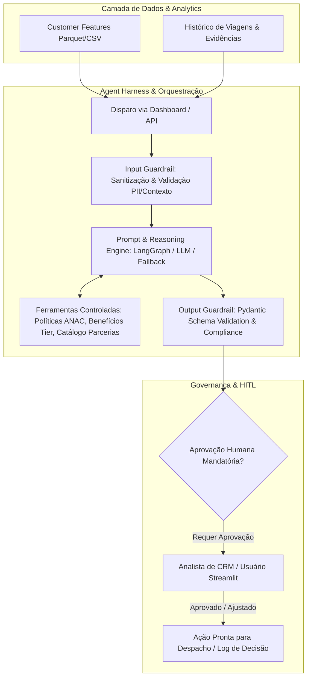

# Base de Conhecimento e Análise Crítica do Projeto: Azul CRM de Alto Valor

**Projeto:** `fidelidade-copilot`  
**Desafio:** DESAFIO 3 — AZUL · CRM de Alto Valor (Hack a Business Azul)  
**Data de Atualização:** 21/10/2026  
**Foco:** Responsabilidades da **Pessoa 3** (Agent do Sistema, Harness e Guardrails)

---

## 1. Visão Geral do Desafio e Problema de Negócioa 

### 1.1 O Desafio
Clientes de alto valor viajam com frequência, geram maior margem de contribuição e sustentam o programa de fidelidade (Azul Fidelidade). Conquistar novos clientes custa significativamente mais do que reter clientes existentes e proteger rotas lucrativas.
O objetivo é entregar um **MVP de CRM de Alto Valor** centrado em IA e dados que:
1. Identifique e priorize perfis de alto valor econômico, comportamental e potencial a partir de dados (sintéticos calibrados com dados públicos ANAC e do programa Azul Fidelidade).
2. Diagnostique sinais precoces de atrito e risco de evasão (churn).
3. Recomende a **Próxima Melhor Ação (Next Best Action - NBA)** de CRM contextualizada, sem desperdiçar margem com incentivos genéricos.
4. Garanta transparência, explicabilidade e **aprovação humana mandatória (Human-in-the-Loop)** antes de qualquer ativação.

### 1.2 Dores do Negócio Identificadas
- **Visão retrospectiva pura:** Foco míope no gasto acumulado passado, ignorando a queda recente de frequência.
- **Perda de sinais precoces de evasão:** Clientes valiosos reduzem viagens ou acumulam atritos (reclamações, atrasos) antes de abandonar a companhia.
- **Desperdício de margem:** Disparo de descontos e milhas massivos e genéricos que canibalizam receita de quem viajaria de qualquer forma ou não resolvem a dor real.
- **Falta de contexto e ação recomendada:** Analistas de CRM têm dados dispersos e pouco tempo para formular a ação certa no momento oportuno.

---

## 2. Dados, Modelagem e Arquitetura Existente

### 2.1 Camadas de Dados e Contratos (`docs/02-dados/data_contracts.yml`, `docs/02-dados/data_dictionary.md`)
- **Tamanho da base:** Exatamente 1.200 clientes sintéticos (`C000001` a `C001200`).
- **Camada Raw:**
  - `customers.csv`: `customer_id`, `signup_date`, `loyalty_tier` (Azul Fidelidade, Topázio, Safira, Diamante, Diamante Unique), `home_airport` (VCP, CGH, SDU, CNF, BSB, REC, SSA, POA, GYN, CWB), `preferred_channel` (app, web, agency).
  - `transactions.csv`: `transaction_id`, `customer_id`, `flight_date`, `origin`, `destination`, `amount_brl`, `qualifying_points`, `cancelled`.
- **Camada Treated:**
  - `data/treated/customers.csv` e `transactions.csv`: Tipagem validada, datas convertidas.
- **Camada Analytics:**
  - `customer_features.parquet` / `.csv`:
    - `trips_12m`: Quantidade de viagens não canceladas nos últimos 12 meses.
    - `spend_12m_brl`: Gasto acumulado no período.
    - `avg_ticket_brl`: Ticket médio.
    - `recency_days`: Dias desde o último voo até a data de corte (`2026-09-30`).
    - `preferred_route`: Rota com maior volume do cliente.
    - `value_score`: Score multicritério ponderado (0 a 100).
    - `churn_risk`: Probabilidade estimada por modelo baseline (Logistic Regression) ou regras.
    - `segment`:
      - *Estratégico* (Score alto, recência recente / risco baixo)
      - *Corporativo em risco* (Score alto, churn_risk alto, queda de frequência) — **CASO PRINCIPAL DA DEMO**
      - *Lazer de alto potencial* / *Frequente* (Potencial de crescimento elevado)
      - *Influenciador de experiência* / *Oportunidade*
    - `priority`: P1 - agir agora, P2 - desenvolver, P3 - observar.
    - `evidence`: Sintetização dos fatores determinantes do score e risco.

### 2.2 Regras de Negócio e Setoriais Cruciais (`Cruzamento de Regras de Negócio - Aéreas.pdf` e `public_sources.md`)
1. **Regulação ANAC (Resolução 400 e correlatas):**
   - *Arrependimento:* 24h com reembolso integral se comprado com antecedência >= 7 dias.
   - *Assistência Material por Atraso/Cancelamento:*
     - > 1h: Comunicação (internet/ligações).
     - > 2h: Alimentação (vouchers).
     - > 4h ou pernoite: Hospedagem e traslado ida/volta.
   - *Bagagem:* 1 volume de mão até 10 kg (soma 115 cm na Azul) + item pessoal. Despacho (23 kg) condicionado a categoria tarifária ou tier.
2. **Azul Fidelidade:**
   - Categorias: Azul Fidelidade (Básico), Topázio, Safira, Diamante e Diamante Unique.
   - Benefícios de Tiers: Pontos qualificáveis multiplicados, franquia de bagagem, assento Espaço Azul, acesso a lounge, atendimento prioritário.
3. **Parcerias Comerciais:**
   - Hotelaria, aluguel de carros (mobilidade local no destino), salas VIP.
   - **Regra de ouro:** Devem ser tratadas e comunicadas como *hipóteses comerciais*, sujeitas a contrato, elegibilidade e orçamento de retenção.

---

## 3. Responsabilidades da Pessoa 3: Agent, Harness e Guardrails

A **Pessoa 3** é responsável pela camada inteligente do sistema: criar o **Agente de CRM**, seu **Test/Runtime Harness** e os **Guardrails** de segurança, conformidade e governança.

### 3.1 O Agente de CRM (Copiloto)
- **Função:** Analisar as evidências do cliente (score, rota frequente, aeroporto base, dias sem viajar, reclamações de atraso, queda de frequência e tier), cruzar com as políticas e recomendar uma intervenção cirúrgica de fidelização.
- **Persona/Prompt do Agente:** Especialista sênior em CRM aéreo e retenção da Azul Linhas Aéreas, empático, financeiramente responsável (protege margem), orientado a dados e ciente das restrições regulatórias.
- **Caso Demonstração P1:** Cliente corporativo de alta renda (ex: rota VCP-LIS ou REC-GRU), que voava quinzenalmente, sofreu atrito recente (reclamação/atraso) e está há mais de 60 dias sem comprar passagens. Ação recomendada: Restituição de experiência com upgrade de assento/voucher de sala VIP ou parceiro de mobilidade corporativa, sem descontos massivos de preço.

### 3.2 O Agent Harness (Orquestração, Execução e Avaliação)
- **Runtime Harness:**
  - Gerenciador do ciclo de vida da chamada ao agente.
  - Injeção controlada de contexto: busca apenas dados relevantes do cliente via schemas estritos.
  - **Fallback Determinístico Mandatório:** Caso o provedor de IA/LLM oscile, caia ou responda fora do schema, o sistema aciona transparentemente o motor de regras determinístico (`src/transform.py` / `pipeline.py`), assegurando zero quebra na demo do pitch.
- **Evaluation & Test Harness (`tests/`):**
  - Casos de teste estruturados para benchmarking da inteligência:
    - *Cenário 1:* Cliente Corporativo em Risco (Alta prioridade, alta retenção).
    - *Cenário 2:* Cliente Premium Recorrente (Fidelização e reconhecimento sem custo excessivo).
    - *Cenário 3:* Cliente Oportunidade / Baixo Valor (Evitar oferta de benefícios caros incompatíveis com a margem).
    - *Cenário 4:* Cenário Limite / Tentativa de Bypass (Tentativa de gerar ação automática sem aprovação humana).

### 3.3 Guardrails (Mecanismos de Segurança e Governança)
1. **Human-in-the-Loop (HITL) Guardrail:**
   - Nenhuma ação pode ser executada ou dada como efetivada sem a marcação explícita de `requires_human_approval: true` e a confirmação do operador de CRM no dashboard.
2. **Input Guardrails:**
   - Bloqueio de dados sensíveis (PII: CPF, telefone, e-mail real).
   - Validação de tipagem e integridade do cliente (ID existente, score entre 0 e 100).
3. **Output Guardrails (Pydantic / Structured Outputs):**
   - Saída 100% tipada contendo:
     - `analysis_summary`: Resumo executivo da situação do cliente.
     - `evidence_factors`: Lista de fatores que motivaram o alerta (ex: recência, atrito, rota).
     - `recommended_action`: Ação clara e prescritiva.
     - `partner_hypothesis`: Parceria sugerida (hotel/mobilidade/lounge) com o disclaimer de hipótese.
     - `estimated_cost_level`: Baixo / Médio / Alto (respeitando margem).
     - `confidence_score`: 0.0 a 1.0.
     - `requires_human_approval`: Booleano estritamente `True`.
     - `regulatory_check`: Validação de conformidade ANAC / regras de fidelidade.
4. **Compliance & Disclaimer Guardrail:**
   - Garantir que toda resposta mencione explicitamente que ofertas de parceiros são hipóteses comerciais e que a base é sintética.

---

## 4. Definition of Done (DoD) Específica da Pessoa 3
- [ ] O agente consome o contrato de dados analíticos sem falhar.
- [ ] A harness possui fallback determinístico automático para quando o modelo LLM estiver offline.
- [ ] Os guardrails de saída validam o formato via Pydantic/JSON Schema.
- [ ] O requisito de aprovação humana é exibido visualmente e programaticamente em todas as recomendações.
- [ ] Nenhum segredo (API keys) é exposto ou versionado no código.
- [ ] Testes automatizados do harness (`test_agent.py`) cobrem o fluxo de sucesso, fallback e rejeição de ações inválidas.

Resp1:   Fiz a varredura completa e análise crítica de toda a documentação, bases de dados e regras de negócio presentes no repositório. Conforme a regra de projeto, consolidei todo esse
mapeamento detalhado no arquivo de conhecimentos: conhecimentos.md.
Abaixo está o resumo executivo e técnico do contexto, alinhado à sua responsabilidade como Pessoa 3 (Agent, Harness e Guardrails):
──────
### 1. O Desafio e o Problema de Negócio
• Objetivo central: Entregar um MVP com dados e IA no centro para identificar clientes de alto valor econômico/comportamental, prever risco de evasão (churn precoce) e recomendar
estratégias de CRM contextuais (Next Best Action - NBA) para fidelizá-los sem queimar margem.
• Caso demonstrativo principal do Pitch: O cliente sintético Corporativo em Risco (P1) — cliente de alta receita/score que apresentou queda de frequência e atrito recente (ex.:
atrasos/reclamações na rota frequente), precisando de uma ação rápida e cirúrgica de reconquista.
• Restrição de Ouro (HITL): A solução não executa ações autônomas. Toda recomendação requer aprovação humana mandatória (Human-in-the-Loop) antes de qualquer ativação.
• Parcerias Comerciais: Sugestões de mobilidade, hotelaria e mimos são hipóteses comerciais sujeitas a contrato, disponibilidade e elegibilidade.
──────
### 2. Cruzamento de Regras de Negócio e Setoriais

Documentos analisados: Cruzamento de Regras de Negócio - Aéreas.pdf e public_sources.md.

1. Regulação ANAC (Resolução 400):
    • Arrependimento de compra: Reembolso integral até 24h pós-compra se realizada com 7+ dias de antecedência.
    • Assistência Material por Atrasos: > 1h (comunicação), > 2h (alimentação/vouchers), > 4h ou pernoite (hospedagem e traslado).
    • Bagagem de mão: Até 10 kg (soma de 115 cm na Azul) + item pessoal. Despacho (23 kg) atrelado à tarifa ou status.
2. Azul Fidelidade (Tiers e Benefícios):
    • Categorias: Azul Fidelidade, Topázio, Safira, Diamante e Diamante Unique.
    • Ações de CRM devem respeitar o patamar do cliente (ex.: cortesia de Espaço Azul, upgrades de cabine, vouchers de parceiros e bônus de pontos qualificáveis).
──────
### 3. Responsabilidades da Pessoa 3: Arquitetura do Agente

                            [Entrada: Perfil Analítico do Cliente]
                                           │
                                           ▼
                              ┌─────────────────────────┐
                              │     Input Guardrail     │
                              │  (Anti-PII & Sanity)    │
                              └────────────┬────────────┘
                                           │
                                           ▼
                              ┌─────────────────────────┐
                              │      Agent Harness      │
                              │  (Orquestração & Tools) │
                              └─────┬─────────────┬─────┘
                       Chamada LLM  │             │ Fallback Determinístico
                                    ▼             ▼ (Se LLM offline)
                              ┌─────────────────────────┐
                              │    Output Guardrail     │
                              │ (Pydantic & Compliance) │
                              └────────────┬────────────┘
                                           │
                                           ▼
                              ┌─────────────────────────┐
                              │  Human-in-the-Loop      │
                              │ (Aprovação Obrigatória) │
                              └─────────────────────────┘

#### A. O Agente (src/agent/)

• Persona: Especialista de CRM e Retenção da Azul.
• Função: Receber o perfil (high_value_score, churn_risk, trips_12m, recency_days, preferred_route, atritos e tier), formular o diagnóstico de causa-raiz e prescrever a próxima melhor
ação de CRM.
• Tools controladas: Consulta a benefícios por tier, checagem de conformidade ANAC e catálogo de hipóteses de parcerias locais por aeroporto.

#### B. O Harness (src/agent/harness.py e tests/test_agent.py)

• Runtime Harness: Injeção de contexto estruturado e fallback determinístico robusto (caso o LLM não responda ou falhe na validação, o motor do transform.py entra em ação
imediatamente, garantindo que a demo nunca quebre).
• Evaluation Harness: Bateria de testes automatizados com perfis sintéticos de teste (ex.: cliente corporativo em risco, cliente VIP promotor, cliente lazer oportunidade e cenários de
tentativa de bypass de regras).

#### C. As Guardrails (src/agent/guardrails.py)

• Input Guardrails: Verificação de integridade dos dados e bloqueio de PII.
• Output Guardrails (Pydantic Model): Validação estrita de formato:
    • customer_id
    • diagnosis (análise de risco e valor)
    • evidence_factors (motivos da prioridade)
    • recommended_action (ação cirúrgica de retenção)
    • partner_hypothesis (parceiro sugerido + disclaimer obrigatório de hipótese)
    • confidence_score (0.0 a 1.0)
    • requires_human_approval (obrigatoriamente True)
• Compliance Guardrail: Impedir que o modelo sugira descontos abusivos que queimem margem ou invente contratos inexistentes.
──────
### Próximos Passos

Tudo está mapeado e documentado no conhecimentos.md. Estamos prontos para implementar os módulos do agente (src/agent/), seus guardrails Pydantic e os testes do harness. Como deseja
prosseguir?
