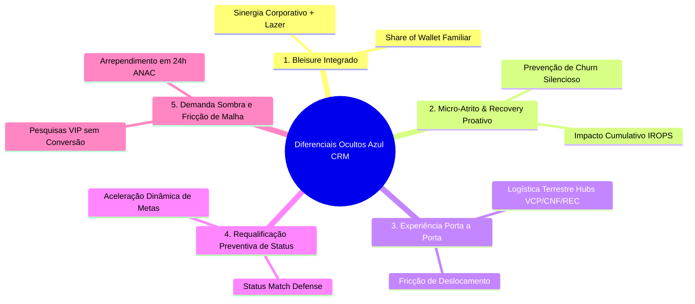

# Mapeamento Estratégico de Diferenciais Ocultos e Matriz de Coleta de KPIs para o Agente de CRM

**Projeto:** `fidelidade-copilot` — Desafio 3: Azul CRM de Alto Valor  
**Destinatário Técnico:** Equipe do Projeto / Responsável pela Camada de Agente, Harness e Guardrails (Pessoa 3)  
**Objetivo:** Identificar lacunas estratégicas que passam despercebidas na análise tradicional de CRM aéreo e estruturar uma bateria de 35 perguntas de múltipla escolha e 35 perguntas abertas para enriquecer a base analítica e instrumentalizar os KPIs do Agente Inteligente.

---

## Sumário Executivo

A análise convencional de CRM aéreo costuma monitorar métricas retroativas agregadas: RFV tradicional (Recência, Frequência, Valor monetário), tier atual e gasto acumulado em 12 meses. Contudo, essa abordagem tradicional deixa pontos cegos críticos. Clientes de alto valor não abandonam uma companhia repentinamente; eles sofrem micro-atritos acumulados, enfrentam fricções logísticas de porta a porta, sentem desestímulo no ciclo de requalificação de status ou vivenciam uma ruptura entre suas viagens corporativas e pessoais.

Abaixo são detalhados **5 diferenciais estratégicos não óbvios**, seguidos de uma bateria de perguntas para extração de novos KPIs direcionados ao Agente de CRM, seus Guardrails e seu Harness de decisão.

---



---

# DIFERENCIAL 1: Sinergia "Bleisure" e o Share of Wallet Familiar Oculto

### O Detalhe que Passa Despercebido:
O executivo de alto valor voa frequentemente a trabalho faturado pela empresa (via TMCs e agências corporativas). As companhias tratam esse passageiro estritamente sob a ótica B2B. No entanto, o verdadeiro diferencial de fidelização e proteção de margem reside em transformar a preferência corporativa em viagens de lazer com familiares (B2C de alta rentabilidade). Quem decide a viagem de férias da família ou a extensão de um compromisso de sexta para domingo (bleisure) é o mesmo passageiro de alta renda. Tratar o cliente corporativo como um indivíduo isolado ignora o potencial de captura de viagens de múltiplos assentos com tarifas cheias.

---

### Perguntas Objetivas de Múltipla Escolha (Diferencial 1)

1. **Qual é o comportamento mais comum do passageiro corporativo frequente quando viaja a lazer?**
   - a) Compra na mesma companhia utilizando pontos do programa de fidelidade corporativo/pessoal.
   - b) Pesquisa apenas no comparador de preços e opta pela concorrente de menor tarifa.
   - c) Prefere voar na Azul somente se houver voo direto sem escalas a partir do aeroporto base.
   - d) Divide a compra: emite o próprio bilhete com pontos e compra passagens dos familiares na concorrente.

2. **Qual proporção das viagens do cliente corporativo de alto valor inclui extensão de estadia para o fim de semana (sexta a domingo)?**
   - a) Menos de 5% das viagens anuais.
   - b) Entre 6% e 15% das viagens anuais.
   - c) Entre 16% e 30% das viagens anuais.
   - d) Acima de 30% das viagens anuais.

3. **Qual benefício de fidelidade possui maior peso para estimular a compra de bilhetes de lazer familiares?**
   - a) Desconto percentual em tarifas promocionais.
   - b) Marcação gratuita de assento Espaço Azul e despacho de bagagem de 23 kg para todos os acompanhantes da reserva.
   - c) Cortesia de transfer terrestre compartilhado até o aeroporto.
   - d) Dobro de pontos qualificáveis em voos nos finais de semana.

4. **Qual é a média de acompanhantes em viagens de lazer do cliente categorizado como Diamante / Diamante Unique?**
   - a) Viaja predominantemente desacompanhado (1 passageiro).
   - b) Exatamente 1 acompanhante (casal).
   - c) De 2 a 3 acompanhantes (núcleo familiar direto).
   - d) 4 ou mais acompanhantes (família estendida / grupos).

5. **Como o cliente corporativo costuma emitir passagens de lazer para familiares?**
   - a) 100% via resgate de pontos no Azul Fidelidade.
   - b) Combinação de pontos + dinheiro (tarifa mista).
   - c) 100% em cartão de crédito corporativo ou pessoal em canal direto (App/Web).
   - d) Através de agência de turismo de lazer externa não vinculada à empresa.

6. **Quando o cliente corporativo reserva uma viagem de lazer, com qual antecedência média ele compra os bilhetes em comparação às viagens de trabalho?**
   - a) Mesma antecedência (compras de última hora, < 7 dias).
   - b) De 8 a 21 dias antes do voo.
   - c) De 22 a 60 dias antes do voo.
   - d) Mais de 60 dias de antecedência.

7. **Qual é o principal obstáculo apontado por clientes de alto valor para não voarem com a Azul em viagens de férias?**
   - a) Falha de disponibilidade de assentos contíguos na cabine para a família.
   - b) Política restritiva de bagagem para tarifas mais econômicas.
   - c) Malha focada em hubs secundários que exige conexões demoradas em horários de pico familiar.
   - d) Incompatibilidade das ofertas de hotéis/parceiros no programa de fidelidade.

---

### Perguntas Abertas (Diferencial 1)

1. De que maneira podemos correlacionar transações B2B (faturadas via agência corporativa) com cadastros de pessoa física para mapear o núcleo familiar do passageiro sem violar a privacidade?
2. Quais gatilhos de comportamento digital no app da Azul indicam que um cliente corporativo está pesquisando uma viagem de lazer em vez de uma viagem profissional?
3. Como uma política de "Upgrade Familiar de Cortesia" ou "Bagagem Compartilhada" para clientes Safira e Diamante influenciaria a decisão de compra de bilhetes de alta margem?
4. Que tipo de parceria turística (ex.: resorts no Nordeste, hotéis boutique em Gramado ou mobilidade local) agrega valor real percebido para o viajante corporativo em modo férias?
5. Qual impacto econômico a Azul teria ao conceder benefícios de tier aos acompanhantes no mesmo localizador (PNR), comparado ao ganho incremental de receita de bilhetes pagos?
6. Como o Agente de CRM deve formular uma oferta de "Extensão Bleisure" personalizada quando detecta uma viagem corporativa com retorno na quinta ou sexta-feira em um destino turístico?
7. Quais sinais indicam que um cliente corporativo de alto valor deixou de comprar lazer na Azul e passou a concentrar suas férias em programas concorrentes (LATAM Pass / Smiles)?

---

### Mapeamento de KPIs para o Agente e Justificativa Técnica/Negócio

| KPI Extraído | Nome Técnico no Agente | Tipo | Justificativa Técnica e de Negócio |
|---|---|---|---|
| **Taxa de Penetração Lazer/Corporativo** | `leisure_to_corporate_ratio` | Float (0 a 1) | Mede a razão entre viagens de lazer e negócios. Se for zero para um cliente de alto gasto corporativo, sinaliza oportunidade imediata de cross-sell sem custo de aquisição. |
| **Share of Wallet Familiar** | `family_pnr_share` | Float (0 a 1) | Identifica localizadores com múltiplos passageiros associados ao titular VIP. Alimenta o modelo de propensão a pacotes turísticos e upgrades de grupo. |
| **Média de Acompanhantes em Lazer** | `avg_leisure_party_size` | Integer | Permite ao Agente calcular a margem agregada da recomendação antes de oferecer cortesias como bagagem despachada ou assento especial. |
| **Lead Time Diferencial** | `booking_lead_time_delta_days` | Integer | Diferença de antecedência de compra entre lazer e negócio. Permite ao Agente antecipar campanhas de férias 60 dias antes da data provável. |
| **Taxa de Extensão de Final de Semana (Bleisure)** | `bleisure_stay_rate` | Percentual | Frequência com que o passageiro estende viagens de negócios ao fim de semana. Permite sugerir tarifas combinadas ou hotéis parceiros no destino de trabalho. |

---

# DIFERENCIAL 2: Micro-Atritos Acumulados e o "Recovery" Proativo antes do Churn Silencioso

### O Detalhe que Passa Despercebido:
O passageiro de alto valor raramente telefona para reclamar de pequenos atrasos ou mudanças de portão; ele simplesmente para de comprar passagens e migra para a concorrência após dois ou três eventos negativos. As companhias cumprem a Resolução 400 da ANAC reativamente (oferecendo água após 1h, alimentação após 2h e hotel após 4h), tratando o passageiro VIP da mesma forma burocrática que o passageiro esporádico. O diferencial oculto é o cálculo do **Índice de Fricção Operacional Acumulada Ponderada pelo Valor**. Uma recuperação proativa imediata antes que o cliente sinta o cansaço do atrito neutraliza o churn antes de qualquer queda de score de recência.

---

### Perguntas Objetivas de Múltipla Escolha (Diferencial 2)

1. **Qual evento operacional gera o maior índice de frustração e probabilidade de churn para um passageiro corporativo?**
   - a) Atraso na decolagem de 45 a 90 minutos que provoca perda de reunião presencial.
   - b) Troca inesperada de portão de embarque no terminal.
   - c) Falha ou indisponibilidade do Wi-Fi a bordo durante o voo.
   - d) Atraso na restituição de bagagem despachada na esteira superior a 30 minutos.

2. **Quantas ocorrências operacionais desfavoráveis (atrasos, cancelamentos, overbooking) costumam ocorrer antes de um cliente Diamante reduzir seus voos em 50%?**
   - a) Apenas 1 ocorrência grave.
   - b) De 2 a 3 ocorrências acumuladas em uma janela de 60 dias.
   - c) De 4 a 6 ocorrências ao longo do ano.
   - d) Ocorrências operacionais não afetam a frequência de clientes corporativos fiéis.

3. **Qual é o tempo ideal para o CRM da Azul abordar um cliente de alto valor impactado por um cancelamento de voo ou atraso relevante?**
   - a) Tempo real / até 2 horas após a aterrissagem ou resolução do voo.
   - b) Entre 24h e 48h após o incidente.
   - c) Apenas após a manifestação do cliente via SAC ou Consumidor.gov.
   - d) No ciclo de envio mensal da régua de comunicação de fidelidade.

4. **Qual formato de compensação pró-ativa gera o maior índice de retenção percebida por clientes de alta renda?**
   - a) Voucher impresso de alimentação no terminal de R$ 50,00.
   - b) Crédito automático em pontos qualificáveis + pedido formal de desculpas via App.
   - c) Upgrade de cabine ou acesso gratuito ao Lounge Azul na próxima viagem.
   - d) Desconto percentual condicionado à compra de um novo bilhete internacional.

5. **Como a assistência material obrigatória da ANAC (Res. 400) é percebida pelo cliente corporativo de alta margem?**
   - a) Extremamente positiva e suficiente para sanar o transtorno.
   - b) Como mera obrigação legal burocrática, sem impacto positivo na fidelidade.
   - c) Irrelevante, pois o executivo prefere pagar o próprio hotel/alimentação para evitar filas.
   - d) Prejudicial, caso envolva vouchers de baixa qualidade ou espera prolongada.

6. **Qual proporção de clientes de alto valor afetados por IROPS (operações irregulares) abre reclamação formal no SAC?**
   - a) Menos de 15% (churn silencioso predominante).
   - b) Entre 16% e 40%.
   - c) Entre 41% e 70%.
   - d) Mais de 70% acionam os canais oficiais.

7. **Qual canal digital apresenta maior taxa de abertura e conversão para ações de desculpas e recuperação de confiança?**
   - a) E-mail marketing tradicional.
   - b) Push notification personalizada no App oficial da Azul.
   - c) Mensagem direta via WhatsApp corporativo oficial da Azul.
   - d) Ligação telefônica da equipe de atendimento VIP (Concierge).

---

### Perguntas Abertas (Diferencial 2)

1. De que forma podemos construir um índice algorítmico de "Fadiga de Viagem" que pondere atrasos em minutos, conexões perdidas e cancelamentos sofridos nos últimos 90 dias?
2. Como o Agente de CRM pode diferenciar um cliente tolerante a atrasos de um executivo com tolerância zero à impontualidade com base em dados de navegação e histórico?
3. Quais guardrails de custo devem ser aplicados a uma ação de recovery (ex.: concessão de milhas ou upgrades) para não deteriorar a margem financeira gerada pelo cliente?
4. Por que a concessão de pontos qualificáveis após uma falha de serviço é mais eficiente do que pontos bônus resgatáveis convencionais para clientes de categorias superiores?
5. Como integrar os dados de telemetria de voos e ocorrências operacionais (VRA ANAC / bases de aeroportos) em tempo quase real ao pipeline do Agente?
6. De que maneira um fluxo de "Human-in-the-Loop" no dashboard Streamlit pode alertar a mesa de CRM sobre clientes VIP aterrissando após atrasos superiores a 2 horas?
7. Como evitar que clientes corporativos simulem atritos operacionais menores para obter benefícios recorrentes indevidos do Agente de CRM?

---

### Mapeamento de KPIs para o Agente e Justificativa Técnica/Negócio

| KPI Extraído | Nome Técnico no Agente | Tipo | Justificativa Técnica e de Negócio |
|---|---|---|---|
| **Índice de Fricção Operacional Ponderada** | `weighted_friction_index` | Float (0 a 100) | Pondera atrasos (minutos), voos cancelados e bagagens desviadas pelo ticket médio do cliente. Se ultrapassar o limiar crítico, dispara alerta P1 de intervenção imediata. |
| **Taxa de Atrito Silencioso** | `silent_churn_propensity` | Probabilidade (0 a 1) | Predição da chance do cliente reduzir viagens sem ter registrado reclamação formal no SAC após um evento de IROPS. |
| **Tempo de Resposta do Recovery** | `recovery_lead_time_hours` | Float | Tempo transcorrido entre a ocorrência operacional e a abordagem proativa do CRM. Quanto menor o tempo, maior a taxa de reversão de churn. |
| **Eficácia da Compensação** | `nps_post_recovery_delta` | Float (-100 a +100) | Variação do sentimento ou frequência de compra após o cliente receber uma compensação personalizada versus clientes sem abordagem. |
| **Custo de Retenção sobre Margem** | `recovery_cost_to_margin_ratio` | Percentual | Assegura que o valor financeiro do benefício concedido (voucher, pontos, assento) não exceda 5% a 10% da margem líquida anual estimada do cliente. |

---

# DIFERENCIAL 3: A Experiência "Porta a Porta" e a Fricção Logística dos Hubs

### O Detalhe que Passa Despercebido:
A Azul possui sua maior fortaleza de malha em aeroportos estruturantes e hubs estratégicos: **Viracopos (VCP - Campinas)**, **Confins (CNF - Belo Horizonte)** e **Recife (REC)**. Contudo, para muitos clientes corporativos de alto valor residentes em capitais (como São Paulo e Belo Horizonte), o deslocamento terrestre até o aeroporto é o maior fator de estresse e cansaço da viagem. A decisão entre voar Azul a partir de VCP ou voar concorrentes a partir de Congonhas (CGH) ou Guarulhos (GRU) é frequentemente pautada pelo tempo de trânsito rodoviário e custo de estacionamento. Conectar o bilhete aéreo à mobilidade terrestre premium resolve a principal dor que faz o cliente optar pela concorrência.

---

### Perguntas Objetivas de Múltipla Escolha (Diferencial 3)

1. **Qual é a principal objeção de executivos da cidade de São Paulo em relação aos voos internacionais ou nacionais com saída de Campinas (Viracopos)?**
   - a) Menor frequência de horários de voo.
   - b) Tempo e imprevisibilidade do trânsito na saída da capital pela Rodovia dos Bandeirantes/Anhanguera.
   - c) Infraestrutura e qualidade dos serviços do terminal de passageiros de VCP.
   - d) Oferta de salas VIP nos terminais.

2. **Qual serviço de mobilidade terrestre agregaria maior valor para o cliente corporativo que viaja semanalmente via VCP ou CNF?**
   - a) Desconto em diárias de estacionamento no terminal aeroportuário.
   - b) Ônibus executivo com horários dedicados e Wi-Fi de alta velocidade saindo de pontos nobres da capital.
   - c) Parceria com aplicativos de corrida premium ou motorista particular executivo agendado.
   - d) Estações de recarga gratuita para veículos elétricos e híbridos no aeroporto.

3. **Qual percentual do tempo total da experiência de viagem do cliente corporativo é consumido em trajetos terrestres e procedimentos pré-embarque?**
   - a) Menos de 20% do tempo total.
   - b) Entre 25% e 40% do tempo total.
   - c) Entre 45% e 60% do tempo total.
   - d) Mais de 60% do tempo total em rotas de curta duração (ex.: Rio-SP ou BH-SP).

4. **Como o cliente de alta renda avalia a facilidade de embarque e conexão rápida no terminal de Viracopos comparado a Congonhas e Guarulhos?**
   - a) Considera VCP muito superior em agilidade, segurança e conforto interno.
   - b) Considera equivalente a Guarulhos.
   - c) Prefere Congonhas unicamente pela proximidade geográfica de escritórios corporativos.
   - d) Não percebe diferenças de tempo entre os terminais.

5. **Qual é o perfil de cliente mais sensível a benefícios de transporte e mobilidade terrestre?**
   - a) O cliente a lazer viajando sozinho em tarifa promocional.
   - b) O cliente corporativo solo com viagens no mesmo dia (bate-e-volta).
   - c) Famílias com crianças pequenas em viagens de férias prolongadas.
   - d) Passageiros em voos internacionais de conexão noturna.

6. **Qual modelo de monetização de parceria terrestre a Azul deve adotar para clientes Diamante?**
   - a) Parceria totalmente subsidiada pela Azul em casos de alto risco de churn.
   - b) Co-pagamento: acúmulo de pontos qualificáveis ao utilizar serviços de parceiros homologados.
   - c) Inclusão automática em tarifas corporativas flexíveis ou executivas.
   - d) Benefício condicionado a metas de frequência mensal atingidas.

7. **Qual impacto a pontualidade do ônibus executivo gratuito da Azul em São Paulo exerce sobre a percepção de pontualidade geral da companhia?**
   - a) Impacto nulo, pois o cliente separa o transporte terrestre do voo.
   - b) Impacto marginal (< 5% na percepção).
   - c) Impacto crítico: um atraso no ônibus rodoviário é imputado à Azul como se fosse um atraso de voo.
   - d) O serviço é percebido como mera comodidade opcional.

---

### Perguntas Abertas (Diferencial 3)

1. Como podemos calcular o "Tempo de Deslocamento Total Porta a Porta" (Total Door-to-Door Time) e utilizá-lo como feature de sensibilidade competitiva no Agente?
2. Quais bairros e polos corporativos em São Paulo, Campinas e Belo Horizonte concentram o maior número de clientes P1 (alto valor e risco) da base sintética?
3. Como estruturar uma regra de negócio que recomende vouchers de transporte executivo apenas quando a margem do bilhete aéreo justificar o custo operacional da parceria?
4. De que maneira as características operacionais de Viracopos (menor saturação de pista e menor tempo de taxiamento que GRU/CGH) podem ser destacadas como argumento de eficiência pelo Agente?
5. Quais parceiros de mobilidade urbana (locadoras como Localiza/Unidas, apps como Uber Black ou frotas de transfer privado) geram maior sinergia com o cliente Diamante?
6. Como o Agente de CRM pode antecipar um alerta de congestionamento rodoviário na rota para Viracopos e disparar uma notificação com sugestão de antecipação de check-in?
7. Quais guardrails devem ser estabelecidos para garantir que o Agente nunca prometa horários de transfer que possam induzir o passageiro a perder o horário de voo?

---

### Mapeamento de KPIs para o Agente e Justificativa Técnica/Negócio

| KPI Extraído | Nome Técnico no Agente | Tipo | Justificativa Técnica e de Negócio |
|---|---|---|---|
| **Tempo Total Estimado de Jornada (Porta a Porta)** | `door_to_door_duration_mins` | Integer | Mensura o tempo total de deslocamento casa/trabalho até o destino final. Permite contrapor a proximidade de CGH com a velocidade de processos em VCP. |
| **Taxa de Utilização de Conexões Terrestres** | `ground_shuttle_adoption_rate` | Percentual | Mede o engajamento com serviços de transfer da Azul. Clientes com alta taxa são mais protegidos contra investidas de companhias centradas em CGH. |
| **Índice de Risco por Proximidade Competitiva** | `airport_proximity_risk_index` | Float (0 a 1) | Identifica passageiros cujo endereço base está a menos de 15 km de Congonhas ou Santos Dumont, elevando o risco de atração pela concorrência. |
| **Margem Líquida Pós-Subsídio de Mobilidade** | `net_margin_post_ground_cost` | Decimal (R$) | Garante que o Agente calcule a viabilidade financeira da concessão de benefícios terrestres mantendo rentabilidade positiva. |
| **Sensibilidade a Bate-e-Volta** | `same_day_return_ratio` | Percentual | Frequência de viagens de ida e volta no mesmo dia civil. Público prioritário para mimos de agilidade (fast-track no raio-X e estacionamento VIP). |

---

# DIFERENCIAL 4: Prevenção Ativa da Perda de Status e a Armadilha do Status Match

### O Detalhe que Passa Despercebido:
Os programas de fidelidade tradicionalmente avaliam o rebaixamento de categoria uma vez por ano (geralmente em 31 de dezembro). Entre agosto e outubro, muitos clientes de alto valor percebem que não conseguirão acumular os pontos qualificáveis ou trechos necessários para sustentar a categoria Safira ou Diamante no ano seguinte. Ao antecipar o rebaixamento, o executivo desanima e aceita propostas de **Status Match** de concorrentes (como Smiles ou LATAM Pass), migrando 100% de seus voos antes mesmo do encerramento do ciclo. Monitorar a **Distância para Requalificação** e criar desafios dinâmicos acelerados de retenção no 3º trimestre é a principal barreira defensiva contra a perda de clientes topo de pirâmide.

---

### Perguntas Objetivas de Múltipla Escolha (Diferencial 4)

1. **Em qual período do ano civil os clientes de categorias superiores (Safira/Diamante) começam a desengajar caso estejam distantes de bater a meta de renovação de status?**
   - a) No 1º trimestre (janeiro a março).
   - b) No 2º trimestre (abril a junho).
   - c) No início do 3º trimestre (julho a setembro).
   - d) Somente no mês de dezembro.

2. **Qual é o gatilho mais comum que faz um passageiro Diamante aceitar uma oferta de equivalência de status (Status Match) na concorrência?**
   - a) Sentimento de frustração por não alcançar a meta da Azul por uma margem pequena (< 15% de trechos faltantes).
   - b) Redução dos voos corporativos pela empresa no segundo semestre.
   - c) Oferta de maior franquia de bagagem internacional no programa concorrente.
   - d) Vencimento de pontos expirados sem aviso prévio.

3. **Qual tipo de intervenção de CRM apresenta a maior taxa de conversão para acelerar a requalificação de status em risco?**
   - a) E-mail padrão informando a quantidade de pontos que faltam para o término do ano.
   - b) "Desafio Relâmpago" personalizado: conceder o status completo mediante a realização de 3 novos trechos nos próximos 45 dias.
   - c) Possibilidade de compra de pontos qualificáveis faltantes com 50% de desconto.
   - d) Prorrogação do status por 3 meses mediante o pagamento de taxa de anuidade.

4. **Qual é o impacto financeiro da perda de um cliente Diamante que sofre downgrade para Topázio ou Azul Fidelidade básico?**
   - a) Redução de menos de 10% no faturamento anual daquele CPF.
   - b) Queda estimada entre 20% e 40% nas compras na Azul.
   - c) Queda severa superior a 70% nas viagens, com transferência imediata de rotas para a concorrência.
   - d) O cliente continua voando no mesmo ritmo, pois a escolha de voo depende apenas do horário.

5. **Qual critério de requalificação os clientes executivos consideram mais difícil de atingir no regulamento atual?**
   - a) Acúmulo de pontos qualificáveis em reais gastos (R$ 1 gasto = 1 ponto qualificável em tarifas regulares).
   - b) Quantidade mínima de trechos voados no ano.
   - c) Compras em parceiros não-aéreos credenciados.
   - d) Manutenção de gastos recorrentes no cartão de crédito co-branded Azul Itaú.

6. **Como o Agente de CRM deve classificar um cliente com alto gasto financeiro (R$ 40k+), mas que não atinge a meta de trechos por voar prioritariamente trechos longos?**
   - a) Manter as regras estritas e rebaixar a categoria do cliente.
   - b) Atribuir pontuação de exceção orientada a valor (Spend-based Override) para preservar o status Diamante.
   - c) Oferecer compra de trechos faltantes a preço de custo.
   - d) Ignorar o status e tratá-lo como cliente esporádico.

7. **Qual canal de notificação é mais eficaz para engajar o cliente em metas de requalificação sem parecer invasivo?**
   - a) Termômetro visual de progresso dinâmico na tela inicial do aplicativo da Azul.
   - b) Notificação por SMS de alerta de perda de categoria.
   - c) Carta física entregue em mãos pela tripulação a bordo durante o voo.
   - d) Contato ativo de telemarketing do programa de fidelidade.

---

### Perguntas Abertas (Diferencial 4)

1. Como calcular a velocidade de acúmulo de pontos qualificáveis (Run-Rate Qualificável) e projetar o saldo em 31/12 para cada passageiro de alto valor?
2. De que forma o Agente pode gerar um "Desafio Personalizado de Retenção de Status" ajustado especificamente às rotas e hábitos de voo daquele cliente?
3. Quais são os limites orçamentários e regras de governança para conceder um "Soft Landing" (rebaixamento de no máximo uma categoria por ano) para preservar a relação com o cliente?
4. Como identificar se um cliente Diamante começou a transferir seus voos corporativos para outra companhia aérea meses antes do vencimento anual do status?
5. Qual o papel do cartão co-branded Azul Itaú na redução do atrito de requalificação de status para clientes corporativos de alto poder aquisitivo?
6. Como o Agente de CRM pode sugerir bilhetes em classes superiores (Espaço Azul ou Business) como alavancas de pontuação qualificável acelerada?
7. Quais métricas de churn de longo prazo devem ser comparadas entre clientes que receberam desafios de requalificação versus o grupo de controle que sofreu downgrade padrão?

---

### Mapeamento de KPIs para o Agente e Justificativa Técnica/Negócio

| KPI Extraído | Nome Técnico no Agente | Tipo | Justificativa Técnica e de Negócio |
|---|---|---|---|
| **Distância Projetada para Manutenção de Status** | `tier_qualification_gap_pct` | Percentual | Percentual faltante para renovar a categoria no final do ano civil. Se gap > 30% a 90 dias do corte, aciona gatilho de risco no Agente. |
| **Velocidade de Acúmulo de Trechos** | `run_rate_qualifying_points_per_month` | Float | Ritmo mensal de geração de pontos e trechos. Permite identificar desacelerações repentinas no comportamento de compra. |
| **Propensão a Aceitar Status Match** | `status_match_vulnerability_score` | Float (0 a 1) | Estima a probabilidade de o cliente migrar para Smiles/LATAM Pass com base no gap de requalificação e existência de rotas concorrentes diretas. |
| **Taxa de Conversão de Desafios Rápidos (Fast-Track)** | `fast_track_completion_rate` | Percentual | Efetividade de ofertas personalizadas do tipo "Voe 3 trechos nos próximos 30 dias e garanta seu status Diamante". |
| **LTV Protegido por Ação de Status** | `protected_clv_value` | Decimal (R$) | Valor econômico retido ao manter o cliente engajado no ecossistema, evitando que sua receita anual migre para concorrentes. |

---

# DIFERENCIAL 5: A "Demanda Sombra" (Pesquisas sem Conversão e Desistências em 24h)

### O Detalhe que Passa Despercebido:
Os relatórios de CRM analisam as transações que foram concluídas e faturadas. O que fica totalmente oculto para o time de retenção é o volume de **Pesquisas de Voos Realizadas por Clientes VIP sem Conversão** e as **Desistências no Prazo de 24h** (art. 11 da Resolução 400 da ANAC, que concede arrependimento com reembolso integral). Quando um cliente Diamante pesquisa a rota VCP-REC para datas próximas e não compra, ou compra e cancela nas primeiras 24 horas, há um sinal explícito de atrito: incompatibilidade de horários, preço descolado da concorrência corporativa ou falta de assentos contíguos. O CRM convencional não captura essa intenção não atendida, deixando o cliente livre para emitir na concorrência.

---

### Perguntas Objetivas de Múltipla Escolha (Diferencial 5)

1. **Qual é o principal motivo pelo qual um cliente Diamante pesquisa um voo no app da Azul e decide não finalizar a compra?**
   - a) O horário dos voos disponíveis não atende à agenda de compromissos do passageiro.
   - b) A tarifa no canal da Azul estava significativamente superior à de concorrentes com voos semelhantes.
   - c) Ausência de assentos premium disponíveis (Espaço Azul esgotado).
   - d) Falha no processamento do cartão de crédito corporativo.

2. **Quando um cliente corporativo frequente utiliza o direito de arrependimento em 24 horas (Res. ANAC 400), o que ocorre na sequência?**
   - a) O cliente desiste totalmente de viajar e cancela o compromisso profissional.
   - b) O cliente emite bilhete com horário ou data alternativa na própria Azul.
   - c) O cliente compra imediatamente na concorrente (GOL ou LATAM) para conseguir horário mais conveniente.
   - d) O cliente refaz a compra na Azul dias depois com tarifa promocional.

3. **Qual volume médio de buscas não convertidas um passageiro corporativo realiza antes de migrar temporariamente para a concorrência?**
   - a) Apenas 1 busca com horários desfavoráveis.
   - b) De 2 a 3 buscas em rotas habituais sem confirmação de reserva.
   - c) Mais de 5 buscas em múltiplos dias.
   - d) Clientes corporativos compram sem pesquisar previamente.

4. **Qual é a rota da malha Azul com maior probabilidade de fuga de clientes corporativos para concorrentes em casos de incompatibilidade de horários?**
   - a) Rotas regionais exclusivas do interior paulista ou mineiro.
   - b) Rotas do triângulo corporativo: São Paulo (VCP/CGH/GRU) - Brasília (BSB) - Rio de Janeiro (SDU/GIG).
   - c) Rotas de turismo ecológico (ex.: Bonito ou Fernando de Noronha).
   - d) Rotas internacionais de longo curso (Lisboa e Fort Lauderdale).

5. **Como o Agente de CRM deve agir diante de uma pesquisa não convertida de um cliente classificado como P1 (Corporativo em Risco)?**
   - a) Disparar imediatamente e-mails promocionais genéricos de desconto de passagem.
   - b) Guardar o evento de busca e notificar via push ou consultor caso haja liberação de assento ou ajuste tarifário para aquele trecho específico em até 4 horas.
   - c) Telefonar para o cliente questionando o motivo de não ter comprado.
   - d) Não intervir para evitar desgaste na privacidade de navegação.

6. **Qual indicador revela com maior precisão que um cancelamento voluntário em 24h decorreu de insatisfação operacional e não de mera mudança de planos?**
   - a) O cliente selecionou "motivos pessoais" no formulário padrão de reembolso.
   - b) O cancelamento ocorreu após o cliente tentar contatar o call center sem sucesso para alterar o voo.
   - c) O cancelamento ocorreu na madrugada logo após a reserva.
   - d) O cancelamento foi efetuado pelo canal web sem abertura de chamado.

7. **Qual é o intervalo de tempo crítico para que o Agente de CRM intervenha após uma desistência de compra no canal digital?**
   - a) Em até 30 minutos após o abandono da sessão de pesquisa.
   - b) Entre 1 e 4 horas.
   - c) No dia seguinte (24 horas após).
   - d) Apenas se o cliente voltar a pesquisar nos próximos 7 dias.

---

### Perguntas Abertas (Diferencial 5)

1. De que maneira podemos capturar eventos anônimos de telemetria de buscas (`search_intent_events`) e correlacioná-los ao `customer_id` no pipeline analítico sem introduzir gargalos de processamento?
2. Como o Agente de CRM deve formular uma intervenção quando detecta que um cliente VIP cancelou um bilhete nas primeiras 24 horas por motivo de alteração de horário corporativo?
3. Quais guardrails de privacidade (LGPD) e de governança devem ser observados para que a abordagem baseada em buscas não convertidas não soe intrusiva para o cliente?
4. Como diferenciar a "busca de curiosidade" (sem intenção real de viagem) da "busca de necessidade crítica de agenda corporativa"?
5. De que forma o Agente pode propor alternativas inteligentes quando o voo direto desejado pelo cliente estiver lotado (ex.: oferta de trecho via hub com garantia de conexão rápida e lounge)?
6. Qual o custo de oportunidade (Shadow Revenue Loss) que a Azul deixa de capturar quando horários de voos em rotas como VCP-BSB não coincidem com o início de agendas governamentais/corporativas?
7. Como correlacionar os cancelamentos baseados no artigo 11 da Resolução 400 da ANAC com o histórico de migração para voos de concorrentes operando no mesmo aeroporto de origem?

---

### Mapeamento de KPIs para o Agente e Justificativa Técnica/Negócio

| KPI Extraído | Nome Técnico no Agente | Tipo | Justificativa Técnica e de Negócio |
|---|---|---|---|
| **Taxa de Pesquisas Não Convertidas por VIP** | `vip_search_to_abandon_ratio` | Percentual | Razão entre buscas de rotas e compras efetivadas pelo passageiro de alto valor. Valores acima de 60% indicam atrito severo de malha, preço ou disponibilidade. |
| **Taxa de Arrependimento ANAC 24h** | `anac_cooling_off_cancellation_rate` | Percentual | Frequência com que o cliente compra e cancela dentro do prazo de 24h (art. 11 Res. ANAC 400). Sinal precoce de instabilidade de agenda ou migração para concorrência. |
| **Receita Sombra Perdida** | `shadow_demand_estimated_loss_brl` | Decimal (R$) | Valor financeiro das passagens pesquisadas pelo cliente VIP que deixaram de ser emitidas na Azul em rotas que o cliente voa frequentemente. |
| **Déficit de Horário na Rota** | `schedule_mismatch_flag` | Booleano | Identifica se as buscas não convertidas ocorreram em faixas de horário onde a Azul não possui frequências diretas compatíveis. |
| **Tempo de Abandono da Jornada de Compra** | `session_dropoff_step` | Categórico | Indica a etapa exata em que o cliente desistiu (seleção de assento, tela de pagamento ou escolha de horário), direcionando o foco do recovery. |

---

## Síntese de Integração dos KPIs ao Harness e Guardrails da Pessoa 3

```
  ┌────────────────────────────────────────────────────────────────────────┐
  │                           ENTRADAS DO AGENTE                           │
  │   - RFV Clássico + CLV                                                 │
  │   - Novas Features de Diferenciais:                                    │
  │       * bleisure_stay_rate              * weighted_friction_index        │
  │       * door_to_door_duration_mins      * tier_qualification_gap_pct   │
  │       * vip_search_to_abandon_ratio     * anac_cooling_off_rate        │
  └───────────────────────────────────┬────────────────────────────────────┘
                                      │
                                      ▼
  ┌────────────────────────────────────────────────────────────────────────┐
  │                         AGENT RUNTIME HARNESS                          │
  │   - Avalia a combinação dos índices de atrito e oportunidade           │
  │   - Consulta Catálogo de Hipóteses de Parcerias e Regras ANAC          │
  │   - Se LLM Offline -> Fallback Determinístico Parametrizado            │
  └───────────────────────────────────┬────────────────────────────────────┘
                                      │
                                      ▼
  ┌────────────────────────────────────────────────────────────────────────┐
  │                          OUTPUT GUARDRAILS                             │
  │   - Validação Pydantic (Campos Obrigatórios, Confiança, Custo)         │
  │   - Compliance Guardrail: Limite de Custo sobre Margem                 │
  │   - Human-in-the-Loop Mandatório: requires_human_approval = True       │
  └───────────────────────────────────┬────────────────────────────────────┘
                                      │
                                      ▼
  ┌────────────────────────────────────────────────────────────────────────┐
  │                     AÇÃO RECOMENDADA NO DASHBOARD                      │
  │   Ex.: "Reverter Fricção Operacional na Rota VCP-LIS concedendo        │
  │         Upgrade de Espaço Azul e Transfer Executivo com disclaimer"    │
  └────────────────────────────────────────────────────────────────────────┘
```

1. **Camada de Features (`src/features/` ou `src/transform.py`):**
   - Os novos KPIs devem ser normalizados e incorporados ao dataframe analítico de clientes (`customer_features`), transformando sinais comportamentais em pesos diretos para a tomada de decisão do Agente.
2. **Guardião de Custos e Margem (Cost Guardrail):**
   - As ações prescritas pelo Agente (cortesia de bagagem, upgrade familiar, voucher de mobilidade) têm seu custo estimado confrontado com o `estimated_margin` e o `clv` do cliente. Nenhuma recomendação pode comprometer mais que uma fração pré-definida da margem anual.
3. **Mecanismo de Fallback Confiável:**
   - Caso os serviços de IA estejam indisponíveis durante o pitch ou a avaliação, as novas métricas contam com faixas de corte bem definidas (quantis) que ativam regras determinísticas de recomendação no Streamlit, eliminando qualquer risco de travamento da demonstração.
