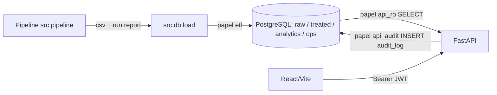

# Operação da plataforma Âncora Azul

Guia para operar, monitorar e auditar o MVP. Todos os dados são **sintéticos**; as métricas de modelo (ex.: ROC-AUC ≈ 0,58) não indicam desempenho em produção.

## 1. Componentes



| Componente | Como roda | Papel de banco |
|---|---|---|
| Pipeline (`python -m src.pipeline`) | gera `data/analytics/*.csv`, valida contrato (pandera, 105 regras) e escreve o relatório da execução | nenhum |
| Carga (`python -m src.db all`) | aplica migrações, carrega raw → treated → analytics e grava `ops.*` | `fidelidade_etl` (ou owner em dev) |
| API (`uvicorn src.api.main:app`) | leitura de `analytics`/`ops`; escrita só da aprovação | `fidelidade_ro` e `fidelidade_api_audit` |
| Frontend (`frontend/`) | só consome a API; nunca acessa o banco | — |

## 2. Configuração (`.env`, nunca versionado)

| Variável | Uso |
|---|---|
| `POSTGRES_PASSWORD`, `POSTGRES_API_PASSWORD`, `POSTGRES_ETL_PASSWORD`, `POSTGRES_AUDIT_PASSWORD` | senhas do owner e dos três logins, usadas na criação do container |
| `DATABASE_URL` | owner (migrações e carga em dev) |
| `DATABASE_URL_ETL` | carga ETL (opcional; padrão `DATABASE_URL`) |
| `DATABASE_URL_RO` | API, somente leitura |
| `DATABASE_URL_AUDIT` | API, endpoint de aprovação e `/audit` |
| `JWT_SECRET` | segredo HS256, ≥ 32 caracteres; ausente ou curto ⇒ a API responde 503 (falha fechada) |
| `RATE_LIMIT_PER_MINUTE`, `RATE_LIMIT_WRITE_PER_MINUTE` | limites por IP (padrão 120 e 20) |
| `CORS_ORIGINS` | origens permitidas, separadas por vírgula |

`scripts\start.ps1` gera `JWT_SECRET` se faltar. O `.env.example` só tem placeholders.

## 3. Subir e parar

```powershell
.\scripts\start.ps1            # container, pipeline, carga, API e front
docker compose down            # para sem apagar dados
docker compose down -v         # APAGA o volume: necessário só para recriar logins/roles novos
```

> Não rode `down -v` em um checkout se outro checkout usa o mesmo container: os dados e logins somem.

Manual: `python -m src.pipeline`, `python -m src.db all`, `uvicorn src.api.main:app --port 8000`, `cd frontend; npm run dev`.

## 4. Banco de dados

### 4.1 Camadas e papéis

| Schema | Conteúdo | Escreve | Lê |
|---|---|---|---|
| `raw` | dados de origem sintéticos | etl | owner |
| `treated` | dados tratados | etl | etl |
| `analytics` | features, HVS, risco, NBA, IVR servidos à API | etl | api_ro, api_audit |
| `ops` | `pipeline_runs`, `data_quality_results`, `model_registry`, `drift_metrics`, `audit_log`, `agent_proposals` | etl (sem `audit_log` e `agent_proposals`); api_audit só insere em `audit_log` e cria/decide `agent_proposals` (UPDATE só nas colunas de decisão) | api_ro (sem `audit_log`); api_audit lê `audit_log` |

`ops.audit_log` é **append-only**: um trigger bloqueia UPDATE, DELETE e TRUNCATE, até para o owner. O owner ainda pode desabilitar o trigger; por isso restrinja o uso do owner em produção e monitore DDL.

### 4.2 Migrações

Versionadas em `db/migrations/`, aplicadas em ordem por `python -m src.db migrate` e registradas em `public.schema_migrations` com checksum. **Nunca edite uma migração aplicada** (o checksum acusa); crie uma nova. Todas devem ser idempotentes.

| Arquivo | Efeito |
|---|---|
| `001_analytics_schema.sql` | schema `analytics` e tabelas servidas à API |
| `002_readonly_role.sql` | papel somente leitura |
| `003_layers_and_roles.sql` | schemas `raw`, `treated`, `ops` e papéis etl/api_audit |
| `004_raw_treated_tables.sql` | tabelas raw e treated |
| `005_ops_tables.sql` | tabelas `ops.*` e trigger de `audit_log` |
| `006_grants.sql` | privilégios mínimos por papel |
| `007_pipeline_run_instrumentation.sql` | colunas de instrumentação (versão de código, seed, linhas por entidade) |
| `008_agent_proposals.sql` | `ops.agent_proposals` (propostas do agente; máquina de estados por trigger) |
| `009_knowledge_base.sql` | extensão `vector` (pgvector), schema `knowledge`: `public_sources` (URL, data de consulta, versão) e `rule_chunks` (chunks + embedding `vector(256)`); versionado, sem UPDATE/DELETE |

### 4.3 Base de conhecimento do RAG (`knowledge`)

- Exige a imagem `pgvector/pgvector:pg16` (já no `docker-compose.yml`). Volume antigo criado com `postgres:16-alpine` deve ser recriado: `docker compose down -v` **no seu checkout**, depois `.\scripts\start.ps1`.
- Fontes ficam em `knowledge/sources/*.md` (front-matter `url`, `title`, `publisher`, `consulted_at`, `license_note` + texto). Só `https` no domínio `voeazul.com.br`, sem PII; veja `_TEMPLATE.md`. O texto é transcrito/resumido por uma pessoa a partir da página pública: nada é raspado automaticamente (o site bloqueia acesso automatizado).
- Ingestão: `python -m src.knowledge` (papel `etl`). Texto igual não muda nada; texto alterado cria nova versão e a anterior deixa de ser corrente (continua no banco para auditoria).
- Embeddings: `hash-256-v1`, determinístico e local (sem credencial). O modelo é gravado por chunk e a busca só compara vetores do mesmo modelo.
- As fontes semeadas são **resumos de pesquisa sem valores numéricos**; critérios e benefícios exatos precisam ser adicionados a partir das páginas oficiais antes de qualquer afirmação numérica pelo agente.

### 4.4 Agente (`src/agent`)

- Ferramentas tipadas e fechadas (`consultar_cliente`, `calcular_elegibilidade`, `buscar_regra`), sobre conexão somente leitura; sem SQL livre.
- Plano fixo de ferramentas; a ação proposta vem sempre da elegibilidade determinística (`requires_approval`), o LLM só redige o texto.
- Provider padrão: `rules` (sem credencial). `AGENT_LLM_PROVIDER=llm` exige `AGENT_LLM_API_KEY`, `AGENT_LLM_BASE_URL` (https) e `AGENT_LLM_MODEL` por ambiente; sem eles, ou em erro/saída inválida, cai em `rules` e registra `fallback_reason`.
- Busca de regras: score mínimo + ao menos uma palavra de conteúdo em comum (embedding por hash é ruidoso). Sem fonte, o agente diz que não encontrou.
- Logs só com metadados (ferramentas, provider, latência).
- Guardrails (`src/agent/guardrails.py`, sem LLM): **entrada** com sanitização (NFKC, caracteres de controle/invisíveis), redação de PII e bloqueio de prompt injection e pedidos de ativação antes de qualquer ferramenta; **saída** com JSON Schema, citação obrigatória de fonte `https://*.voeazul.com.br` (ou aviso explícito de que não há fonte), sem PII, valores/benefícios só se vierem das ferramentas, teto de benefício (maior custo do catálogo de premissas), ação apenas elegível e igual à calculada, `requires_approval` sempre `true` e bloqueio de frases de ativação consumada. Violação do LLM → fallback `rules` (`guardrail_violation`); se ainda violar → recusa segura. O relatório (`guardrails`) guarda só códigos de regra.
- Fontes ingeridas com instruções dirigidas a modelos são rejeitadas na ingestão e, por defesa em profundidade, descartadas do contexto.
- Harness de avaliação (`src/agent/evals.py`, casos em `eval_cases.py`, `tests/test_agent_evals.py`): 27 casos (feliz, sem fonte, adversarial na entrada e na saída do LLM simulado). Mede groundedness, violações de guardrail residuais, contenção adversarial e taxa de fallback; o pytest exige groundedness 1,0, 0 violações residuais e contenção 1,0, e também prova que o harness falha se um guardrail for enfraquecido. Rodar à mão: `python -m src.agent.evals` (usa `DATABASE_URL_RO`). Métricas sobre dados sintéticos e LLM simulado: detectam regressão de política, não desempenho real.

## 5. API

Todas as rotas, exceto `/health`, exigem `Authorization: Bearer <jwt>`. Emissão local:

```powershell
python -m src.api.tokens --sub seu.apelido --role gestor --hours 8   # analista | gestor | auditor, até 24 h
```

| Endpoint | analista | gestor | auditor |
|---|---|---|---|
| `GET /kpis`, `/clientes`, `/clientes/{customer_id}`, `/rotas`, `/nba` | ✔ | ✔ | ✔ |
| `GET /ops/runs`, `/ops/quality`, `/ops/models`, `/ops/drift` | ✔ | ✔ | ✔ |
| `GET /propostas`, `/propostas/{proposal_id}` | ✔ | ✔ | ✔ |
| `GET /nba/aprovacoes` | — | ✔ | ✔ |
| `POST /nba/{customer_id}/aprovacao` | — | ✔ | — |
| `GET /audit` | — | — | ✔ |

Códigos: 401 sem token válido, 403 perfil insuficiente, 404 cliente inexistente, 409 ação sem aprovação exigida ou decisão já registrada, 422 entrada inválida, 429 limite excedido (`Retry-After`), 503 banco ou segredo indisponível.

**Aprovação:** corpo `{decision: approve|reject, reason: 5–500 caracteres}` sem dados pessoais. Grava em `ops.audit_log` quem (`actor`, `actor_role`), quando, o quê (`action`, `entity_id`), `before`/`after` e `request_id`, com lock por cliente. Uma decisão por cliente.

**Proteções:** JWT com `iss`, `sub`, `role`, `iat`, `exp` obrigatórios e validade máxima de 24 h; rate limit por IP em memória (por processo; `X-Forwarded-For` não é confiado); logs JSON no logger `ancora.api` (`request_id`, rota, status, duração, `sub`, `role`; sem query string, corpo ou token); headers CSP, nosniff, X-Frame-Options, HSTS, no-store, Referrer-Policy.

## 6. Rotinas operacionais

### 6.1 Nova execução do pipeline

1. `python -m src.pipeline` e `python -m src.db all`.
2. Confira na aba **Saúde da plataforma** (ou `GET /ops/runs`): status `passed`, duração, `code_version`, `seed` e linhas por entidade.
3. Regras de qualidade com falha aparecem em `/ops/quality` com a regra e a quantidade de linhas; uma execução com falha fica registrada como `failed` e a carga não segue.

### 6.2 Alerta de drift

O PSI por feature é comparado com a baseline da execução anterior (`data/analytics/drift_baseline.json`, local e ignorada pelo git). PSI ≥ 0,2 marca `alert`. Na primeira execução não há linhas de drift. Ao ver alerta:

1. Identifique a feature em `/ops/drift` e compare com a execução anterior.
2. Se for mudança esperada (nova semente ou dados), apague a baseline para recomeçar; se não for, investigue a origem antes de usar HVS, risco e NBA.
3. Registre a decisão (ticket ou `docs/04-processo`); o registro de modelos mantém hash dos dados e métricas de cada versão.

### 6.3 Aprovações e auditoria

- Gestor decide em **Crescer (NBA)**; auditor consulta em **Saúde da plataforma** ou `GET /audit?entity_id=C000001`.
- Consulta direta (papel owner): `SELECT occurred_at, actor, actor_role, action, entity_id, before, after FROM ops.audit_log ORDER BY id DESC LIMIT 50;`
- Correção de uma decisão errada **não** edita o log: faça novo registro por processo manual e documente o motivo.

### 6.4 Rotação de segredos

- `JWT_SECRET`: troque no `.env` e reinicie a API; todos os tokens antigos deixam de valer. Emita novos com `src.api.tokens`.
- Senhas de banco: `ALTER ROLE fidelidade_ro PASSWORD '...'` (idem etl e api_audit), atualize `DATABASE_URL_*` e reinicie. Em dev, `down -v` recria tudo com as senhas do `.env`.
- Se um token vazar: rotacione `JWT_SECRET` (não há lista de revogação) e revise `ops.audit_log` para o `sub` afetado.

### 6.5 Backup e restauração

```powershell
docker exec fidelidade-postgres pg_dump -U fidelidade_owner -Fc fidelidade > backup.dump
docker exec -i fidelidade-postgres pg_restore -U fidelidade_owner -d fidelidade --clean --if-exists < backup.dump
```

Inclua `ops.audit_log` no backup e guarde o arquivo fora do repositório. As camadas `raw`, `treated` e `analytics` podem ser regeradas pelo pipeline (seed determinística `20261014`); o `audit_log` não.

## 7. Monitoramento e resposta a incidentes

| Sintoma | Provável causa | Ação |
|---|---|---|
| 503 em toda a API | `JWT_SECRET` ausente/curto ou banco fora | conferir `.env` e `docker ps`; `/health` responde sem consultar o banco |
| 401 em tudo no frontend | token expirado ou segredo trocado | emitir novo token |
| 403 ao aprovar | perfil não é gestor | usar token de gestor |
| 429 | limite por IP | aguardar `Retry-After`; ajustar `RATE_LIMIT_*` se legítimo |
| `failed` em `/ops/runs` | regra de qualidade quebrou | ver `/ops/quality`, corrigir dado ou regra e rodar de novo |
| Muitos 401/403 de um `sub` nos logs | tentativa de abuso | revisar logs `ancora.api` e rotacionar o segredo se necessário |

Os logs da API são uma linha JSON por requisição em stdout; encaminhe-os ao coletor de logs do ambiente e alerte sobre picos de 401/403/429/5xx.

## 8. Testes

```powershell
.\scripts\test.ps1            # pytest + tsc + vitest (usa o .env para os testes com banco)
python -m pytest -q           # sem banco os testes ao vivo são pulados
```

Os testes com banco criam um banco temporário por módulo a partir de `DATABASE_URL`; nunca use o banco de dados real. Cobertura relevante:

- **Contrato:** `tests/test_contracts.py` (regras pandera) e `tests/test_parity.py` (contrato × pandera × DDL × Pydantic; sem PII).
- **Banco:** `tests/test_db.py` (migrações idempotentes, papéis, `audit_log` imutável, `record_run`).
- **Pipeline e modelos:** `tests/test_pipeline.py`, `test_instrumentation.py`, `test_models.py`, `test_drift.py`.
- **API:** `tests/test_api.py`, `tests/test_api_security.py` (JWT, RBAC, headers, logs, aprovação) e `tests/test_api_hardening.py` (todas as rotas exigem token, métodos, erros sem vazamento, rate limit, CORS).
- **Higiene:** `tests/test_repo_hygiene.py` (sem segredos versionados; este documento cobre cada endpoint e migração).
- **Frontend:** vitest (login, perfis, abas, aprovação).

## 9. Limitações conhecidas

- Tokens são emitidos por CLI, sem login nem IdP; sem revogação individual.
- Rate limit em memória e por processo (use um gateway ou Redis em produção).
- O owner do banco pode desabilitar o trigger do `audit_log`.
- Sem pool de conexões; o frontend guarda o token no `sessionStorage` da aba.
- A baseline de drift é um arquivo local.
- Dados e métricas são sintéticos; ROC-AUC ≈ 0,58 é só ilustrativo.
